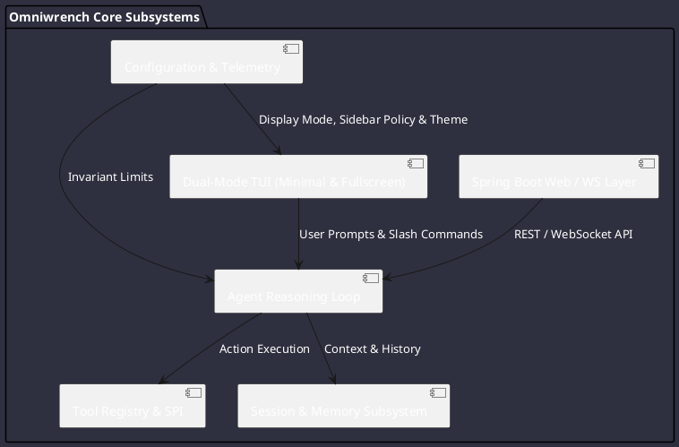

# Omniwrench Architecture Specifications

Omniwrench is engineered as a high-performance, tri-interface autonomous agent runtime (Headless CLI, Dual-Mode Terminal UI, and Reactive Web HUD).

## Architectural Sections

- [System Components](components.md): Deep-dive into subsystem boundaries and responsibilities.
- [AI Terminal Agents Comparative Analysis & Fullscreen TUI Architecture](tui_agents_analysis.md): Source-level and visual layout analysis of OpenCode, Antigravity CLI (`agy`), OpenClaw, Claude Code, Aider, and Crush, plus Omniwrench's `ADR-0063` Dual-Mode TUI design.
- [Package Dependencies](dependencies.md): Maven module and Java package coupling matrix.
- [Execution Sequences](sequences.md): Interactive prompts, tool calls, and subagent delegation sequence diagrams.
- [Reasoning Activities](activities.md): Step-by-step reasoning cycle activity workflows.
- [Class Diagrams & Patterns](classes.md): State, Strategy, and Factory object-oriented patterns.
- [Interfaces & SPIs](interfaces.md): Extensible SPI definitions for tools, listeners, TUI mode engines (`TuiViewModeEngine`), and storage.
- [File Formats & Schema](file_formats.md): JSON/YAML schemas for session serialization and task files.
- [Configuration Specifications](configuration.md): Runtime profiles and property parameters.
