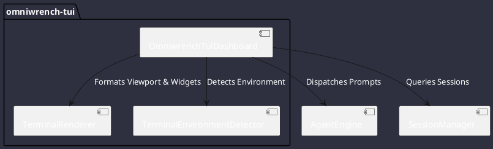

# Component: OmniwrenchTuiDashboard

## Component Metadata

| Property | Value |
|---|---|
| **Component Name** | `OmniwrenchTuiDashboard` |
| **Module** | `omniwrench-tui` |
| **Tier** | Presentation Tier |
| **Package** | `com.omniwrench.tui` |
| **Traceability** | [ADR-0005, ADR-0037, ADR-0043](../../knowledge/knowledge_base.md) |

## Description

Primary interactive terminal dashboard delivering a full-screen Cyberpunk developer interface inspired by OpenCode (`tmp/opencode`). Seamlessly adapts to standard desktop consoles, remote SSH sessions, and tmux multiplexer panes. Features OSC 52 clipboard tunneling, side-channel `/btw` queries, active `/goal` tracking, `/env` runtime inspection, and live reasoning demultiplexing.

## Component Structure & Relationships

## Primary Responsibilities

- Detect operating mode (STANDARD, SSH, TMUX) and configure terminal window title and tmux window names.
- Render responsive Cyberpunk header banner and mode-specific telemetry status pills.
- Route interactive commands: `/btw` (ephemeral prompt), `/goal` (objective management), `/env` (diagnostics), `/copy` (OSC 52 clipboard write), `/clear` (terminal reset), and conversational prompts.
- Demultiplex and display reasoning thought streams separately from assistant dialogue answers.

## Related Architectural Links
- [System Components Overview](../components.md)
- [Module Dependencies](../dependencies.md)
- [Interfaces & SPIs](../interfaces.md)
- [Class Diagrams](../classes.md)
