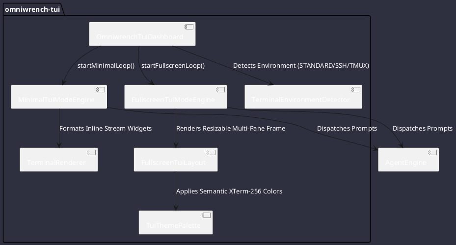

# Component: OmniwrenchTuiDashboard

## Component Metadata

| Property | Value |
|---|---|
| **Component Name** | `OmniwrenchTuiDashboard` |
| **Module** | `omniwrench-tui` |
| **Tier** | Presentation Tier |
| **Package** | `com.omniwrench.tui` |
| **Traceability** | [ADR-0005, ADR-0037, ADR-0043, ADR-0058, ADR-0063](../../knowledge/knowledge_base.md) |

## Description

Primary interactive terminal orchestrator delivering both a **Minimal Inline Stream TUI** (`MinimalTuiModeEngine`, inspired by Claude Code, Aider, and Antigravity CLI inline mode) and a **Full-Screen Dynamically Resizable TUI Workbench** (`FullscreenTuiModeEngine` & `FullscreenTuiLayout`, inspired by OpenCode, Antigravity CLI full-screen mode, OpenClaw, and Crush). Seamlessly adapts to standard desktop consoles, remote SSH sessions, and tmux multiplexer panes across 4 responsive breakpoints (`COMPACT`, `STANDARD_SPLIT`, `WIDE_STUDIO`, `ULTRAWIDE_WORKBENCH`). Features OSC 52 clipboard tunneling, side-channel `/btw` cards, active `/goal` tracking, 6 semantic XTerm-256 themes (`TuiThemePalette`), centered modal overlays (`COMMAND_PALETTE`, `THEME_PICKER`, `HELP`), and live reasoning demultiplexing. See [AI Terminal Agents Analysis](../tui_agents_analysis.md).

## Component Structure & Relationships

## Primary Responsibilities

- Detect operating mode (`STANDARD`, `SSH`, `TMUX`) and configure terminal window title and `tmux` window names.
- Orchestrate mode selection between `TuiDisplayMode.MINIMAL` (`startMinimalLoop()`) and `TuiDisplayMode.FULLSCREEN` (`startFullscreenLoop()`).
- Provide non-interactive snapshot rendering (`renderMinimalSnapshot()`, `renderFullscreenSnapshot()`) for diagnostics and multi-tier tests.
- Route interactive commands across both modes: `/palette`, `/themes`, `/help`, `/close`, `/home`, `/session`, `/sidebar`, `/resize`, `/scroll`, `/theme`, `/thinking`, `/tools`, `/btw`, `/goal`, `/env`, `/copy`, `/clear`, and conversational prompts.

## Related Architectural Links
- [AI Terminal Agents Comparative Analysis](../tui_agents_analysis.md)
- [System Components Overview](../components.md)
- [Module Dependencies](../dependencies.md)
- [Interfaces & SPIs](../interfaces.md)
- [Class Diagrams](../classes.md)
