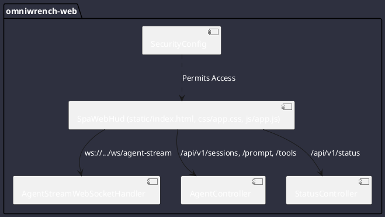

# Component: SpaWebHud

## Component Metadata

| Property | Value |
|---|---|
| **Component Name** | `SpaWebHud` |
| **Module** | `omniwrench-web` |
| **Tier** | Presentation Tier |
| **Package** | `com.omniwrench.web` |
| **Traceability** | [ADR-0018](../../knowledge/knowledge_base.md) |

## Description

Single-Page Application (SPA) Web HUD inspired by OpenCode (`tmp/opencode`), served directly from Spring Boot embedded static resources. Features a dark-theme Cyberpunk aesthetic (`#101010` palette), real-time WebSocket token streaming, multi-session management, collapsible thinking accordions, multi-line auto-resizing composer, and side-channel `/btw` querying.

## Component Structure & Relationships

## Primary Responsibilities

- Serve static web assets (`index.html`, `css/app.css`, `js/app.js`) with responsive CSS Grid and Flexbox layouts.
- Provide real-time streaming dialogue and reasoning token updates via WebSocket (`/ws/agent-stream`) with automatic REST fallback.
- Support multi-session switching, creation, and clearing (`GET/POST /api/v1/sessions`, `DELETE /api/v1/sessions/{id}/messages`).
- Render OpenCode design tokens: collapsible reasoning accordions, syntax-highlighted code blocks with 1-click clipboard copy, and native `<dialog>` overlays.
- Expose OpenCode slash commands in browser: `/btw` (ephemeral prompt), `/goal` (session objective), `/env` (diagnostics drawer), `/tools` (capabilities inspector), and `/clear`.

## Related Architectural Links
- [System Components Overview](../components.md)
- [Module Dependencies](../dependencies.md)
- [Interfaces & SPIs](../interfaces.md)
- [Class Diagrams](../classes.md)
