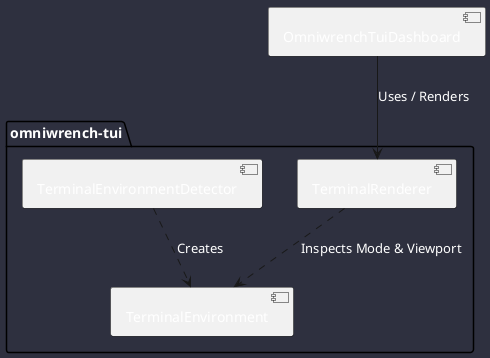

# Component: TerminalRenderer

## Component Metadata

| Property | Value |
|---|---|
| **Component Name** | `TerminalRenderer` |
| **Module** | `omniwrench-tui` |
| **Tier** | Presentation Tier |
| **Package** | `com.omniwrench.tui` |
| **Traceability** | [ADR-0013](../../knowledge/knowledge_base.md) |

## Description

Context-adaptive ANSI and TrueColor terminal renderer inspired by OpenCode and Cyberpunk design systems. Handles responsive banners across varying column widths (<80 narrow layout vs >=80 wide ASCII box layout), environment status pills (`[LOCAL]`, `[SSH:...]`, `[TMUX:...]`), OSC 52 clipboard tunneling with tmux DCS passthrough framing, side-channel `/btw` Q&amp;A cards, `/goal` session cards, and `/env` runtime diagnostic cards.

## Component Structure & Relationships

## Primary Responsibilities

- Detect and adapt to terminal operating mode: `STANDARD` (local desktop), `SSH` (remote connection), and `TMUX` (multiplexer).
- Provide responsive banner folding (< 80 columns collapses to compact Cyberpunk header line).
- Format OSC 52 clipboard escape sequences with tmux DCS passthrough (`\033Ptmux;\033...\007\033\\`).
- Render OpenCode-inspired UI elements: `/btw` side-channel boxes, `/goal` session cards, and `/env` telemetry cards.
- Render borders, text boxes, and ANSI styling efficiently.

## Related Architectural Links
- [System Components Overview](../components.md)
- [Module Dependencies](../dependencies.md)
- [Interfaces & SPIs](../interfaces.md)
- [Class Diagrams](../classes.md)
