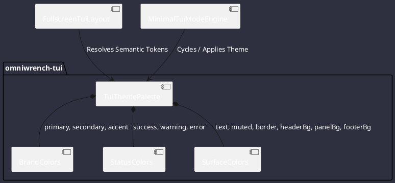

# Component: ThemeEngine & TuiThemePalette

## Component Metadata

| Property | Value |
|---|---|
| **Component Name** | `TuiThemePalette` (`ThemeEngine`) |
| **Module** | `omniwrench-tui` |
| **Tier** | Presentation Tier |
| **Package** | `com.omniwrench.tui` |
| **Traceability** | [ADR-0034, ADR-0057, ADR-0063](../../knowledge/knowledge_base.md) |

## Description

Semantic XTerm-256 (`\033[38;5;<n>m` / `\033[48;5;<n>m`) and ANSI visual theming engine (`TuiThemePalette`) providing 6 built-in themes (`CYBERPUNK`, `OPENCODE`, `DRACULA`, `NORD`, `MATRIX`, `HIGH_CONTRAST`) with grouped value-object token carriers (`BrandColors`, `StatusColors`, `SurfaceColors`).

## Component Structure & Relationships

## Primary Responsibilities

- Provide 6 built-in semantic XTerm-256 themes (`cyberpunk`, `opencode`, `dracula`, `nord`, `matrix`, `high-contrast`).
- Resolve themes by case-insensitive name (`TuiThemePalette.resolve(name)`) with safe fallback to `CYBERPUNK`.
- Support live runtime theme cycling (`TuiThemePalette.nextTheme(current)`) via `/theme` or `/themes` modal overlay.

## Related Architectural Links
- [AI Terminal Agents Comparative Analysis](../tui_agents_analysis.md)
- [System Components Overview](../components.md)
- [Module Dependencies](../dependencies.md)
- [Interfaces & SPIs](../interfaces.md)
- [Class Diagrams](../classes.md)
