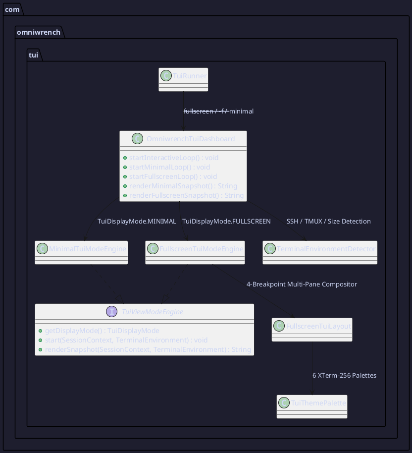

# AI Terminal Agents Comparative Analysis & Fullscreen TUI Architecture

## Metadata

| Property | Value |
|---|---|
| **Document ID** | `ARCH-TUI-2026-016` |
| **Task** | [TSK-20261101-016](../project/tasks/TSK-20261101-016.md) |
| **Requirements** | `REQ-00001`, `REQ-00088`, `REQ-00099` |
| **Architecture Decision** | [ADR-0063 (Dual-Mode Minimal & Fullscreen Resizable TUI Architecture)](../knowledge/knowledge_base.md) |

---

## 1. Executive Summary

Modern terminal AI coding agents have converged around two complementary presentation paradigms:

1. **Minimal Inline Stream Mode** (*Claude Code, Aider, Antigravity CLI inline*): Operates directly in the terminal's primary screen buffer, preserving native terminal emulator scrollback, mouse text selection, and zero-overhead command piping.
2. **Full-Screen Resizable Workbench Mode** (*OpenCode, Antigravity CLI full-screen, OpenClaw, Charmbracelet Crush*): Operates inside the alternate screen buffer (`\033[?1049h`), partitioning the viewport into a top telemetry bar, a multi-pane dockable center canvas (Home route vs. Session transcript route + collapsible Context/Telemetry Sidebar + Ultrawide Explorer), a 3-row bottom prompt composer, a single-line authoritative footer, and centered modal overlays.

Omniwrench implements **both** paradigms natively through the `TuiViewModeEngine` strategy interface (`MinimalTuiModeEngine` and `FullscreenTuiModeEngine`), allowing operators to launch either mode via CLI flags (`--fullscreen` / `-f` or `--minimal`) or configuration (`omniwrench.tui.display-mode`).

---

## 2. Deep-Dive Analysis of Leading AI Terminal Agents

### 2.1 OpenCode (`sst/opencode`)

#### Source Code Architecture (`tmp/opencode-dev/packages/tui/src`)
- **Framework**: `@opentui/solid` (reactive Flexbox terminal DOM with Yoga layout engine).
- **Route Separation (`app.tsx`)**:
  - `Route.HOME` (`routes/home.tsx`): Centered ASCII/Unicode brand logo, model badge, quick-start command tips, and centered prompt composer. Submitting the first prompt transitions automatically to `Route.SESSION`.
  - `Route.SESSION` (`routes/session/index.tsx`): Horizontal `<box flexDirection="row">` containing the scrollable conversation transcript (`flexGrow={1}`) and a dockable right `<Sidebar />` (`width={42}`).
- **Responsive Sidebar Docking (`routes/session/index.tsx` & `sidebar.tsx`)**:
  ```tsx
  const wide = createMemo(() => dimensions().width > 120)
  const sidebarVisible = createMemo(() => {
    if (route.data.type !== "session") return false
    if (sidebar() === "show") return true
    if (sidebar() === "auto" && wide()) return true
    return false
  })
  ```
  The right sidebar displays session title, token/context usage bar, active todo/goal list, active MCP/tool status indicators (`•` colored pills), and modified files.
- **Command Palette Overlay (`component/command-palette.tsx`)**:
  Centered floating modal (`width={60}`) with categorized fuzzy search (`Suggested`, `Session`, `Agent`, `System`, `Theme`).
- **Semantic Theme Engine (`context/theme.tsx`)**:
  Separates semantic UI tokens (`primary`, `secondary`, `accent`, `text`, `textMuted`, `background`, `backgroundPanel`, `backgroundElement`) across themes (`opencode`, `dracula`, `nord`, `tokyonight`, `catppuccin`).

#### Visual Layout Wireframe (OpenCode Fullscreen Session View)
```text
┌──────────────────────────────────────────────────────────┬─────────────────────────────┐
│  ● USER                                                  │ ◆ SESSION & CONTEXT         │
│  │ Refactor the TUI into minimal and fullscreen modes    │   ID:   f49d2a10            │
│  ╰─                                                      │   Context: [██████░░░░] 38% │
│  ◆ AGENT                                                 │                             │
│  │ ┌─ ⚡ REASONING STREAM [high]                         │ ◆ ACTIVE GOAL               │
│  │ │ Inspecting terminal breakpoints and alternate       │   Build dual-mode TUI       │
│  │ │ screen buffer lifecycle...                          │                             │
│  │ └─                                                    │ ◆ TOOLS (6 READY)           │
│  │ ┌─ 🔧 TOOL: file_ops [OK] (8ms)                       │   • command_exec            │
│  │ └─                                                    │   • file_ops                │
│  │ Implemented MinimalTuiModeEngine and Fullscreen...    │   • git_status              │
├──────────────────────────────────────────────────────────┴─────────────────────────────┤
│ ╭─ ❯ PROMPT COMPOSER [Enter: submit | /palette: commands | /sidebar: toggle] ────────╮ │
│ │ omniwrench (session) ❯ _                                                           │ │
│ ╰────────────────────────────────────────────────────────────────────────────────────╯ │
│ 📁 /home/m/git/omniwrench │ • 6 Tools │ ⚙ Think:high │ 🖥 140x40 (WIDE_STUDIO)         │
└────────────────────────────────────────────────────────────────────────────────────────┘
```

---

### 2.2 Antigravity CLI (`agy`) & Gemini CLI

#### Architecture & UX Patterns
- **Dual-Mode Execution**:
  - Supports lightweight inline stream execution (`agy` default) as well as full-screen terminal workspace mode and headless prompt execution (`agy -p <prompt>`).
- **Rich Slash Command Taxonomy**:
  - High-leverage workflow commands (`/goal`, `/plan`, `/compact`, `/teamwork`, `/boost`, `/grill-me`, `/learn`, `/schedule`).
  - Clear visual separation between internal reasoning (`Thinking...`), tool call execution cards (with elapsed time and status), and final markdown responses.
- **Framed Prompt Composer**:
  - Bottom-docked rounded box (`╭───╮` / `╰───╯`) with contextual hints for `/` slash commands and mode indicators.

---

### 2.3 OpenClaw (`openclaw/openclaw`)

#### Source Code Architecture (`tmp/openclaw-main/src/tui`)
- **Framework**: `@earendil-works/pi-tui` (`TUI`, `Container`, `Box`, `Editor`, `SelectList`, `Markdown`).
- **Code-Fence-Preserving Line Wrapper (`tui-formatters.ts`)**:
  - Implements `transformOutsideCode(text, fn)` which splits markdown lines on triple-backtick (```` ``` ````) and tilde (`~~~`) fences so prose is word-wrapped to the pane width while code blocks are never corrupted by word-wrapping.
- **Inline Ephemeral `/btw` Side-Channel Component (`components/btw-inline-message.ts`)**:
  - Renders side-channel questions in a dedicated dismissible inline card without polluting the primary conversation transcript.
- **Collapsible Thinking & Tool Cards (`components/chat-log.ts` & `tool-execution.ts`)**:
  - Allows expanding/collapsing thinking blocks (`/thinking toggle`) and tool execution output (`/tools toggle`) on demand.
- **Single-Line Authoritative Footer (`tui.ts`)**:
  - Consolidates workspace path, session/agent status, thinking effort level, and viewport dimensions into a single scannable bottom line.

---

### 2.4 Claude Code, Aider & Charmbracelet Crush

| Agent | Signature UX Strengths Adopted by Omniwrench |
|---|---|
| **Claude Code** | Frictionless inline stream mode (`MinimalTuiModeEngine`), zero-flicker scrollback preservation, concise tool status lines, collapsible thinking preview. |
| **Aider** | Explicit repository/workspace awareness in the header/footer, clean command-driven ergonomics (`/run`, `/cat`, `/clear`, `/copy`). |
| **Charmbracelet Crush** | Lipgloss-style rounded Unicode borders (`╭─╮│╰─╯`), high-contrast semantic XTerm-256 palettes, and responsive multi-pane terminal docking. |

---

## 3. Omniwrench Dual-Mode TUI Synthesis (`ADR-0063`)

### 3.1 Component Architecture



### 3.2 Responsive Fullscreen Breakpoints (`FullscreenTuiLayout`)

| Breakpoint | Column Range | Layout Topology |
|---|---|---|
| **`COMPACT`** | `< 80` cols | Single-column canvas (Header + Main Canvas + Composer + Footer). Sidebars auto-collapse so narrow tmux panes remain readable. |
| **`STANDARD_SPLIT`** | `80 .. 119` cols | Dual-pane layout: Main Canvas (`cols - 30`) + Right Context & Telemetry Sidebar (`30` cols). |
| **`WIDE_STUDIO`** | `120 .. 159` cols | OpenCode Studio layout: Main Canvas (`cols - 38`) + Rich Right Context, Goal & Tools Sidebar (`38` cols). |
| **`ULTRAWIDE_WORKBENCH`** | `>= 160` cols | 3-Pane Workbench: Left Explorer (`26` cols) + Center Main Canvas + Right Context & Telemetry Sidebar (`38` cols). |

### 3.3 Launch Options

1. **CLI Launch Flags**:
   - Fullscreen Resizable Workbench:
     - `omniwrench --fullscreen` or `omniwrench -f`
     - `omniwrench tui --fullscreen` or `omniwrench tui -f`
     - `omniwrench tui-full`
     - `./omniwrench-helper.sh fullscreen` (or `./omniwrench-helper.sh tui-full`)
   - Minimal Inline Stream Mode:
     - `omniwrench tui` (default)
     - `omniwrench --minimal` or `omniwrench tui --minimal`
     - `./omniwrench-helper.sh minimal` (or `./omniwrench-helper.sh tui`)
2. **Environment & Spring Configuration (`application.yml`)**:
   - `OMNIWRENCH_TUI_MODE=fullscreen` (`omniwrench.tui.display-mode: fullscreen`)
   - `OMNIWRENCH_TUI_SIDEBAR=auto` (`omniwrench.tui.sidebar-mode: auto|show|hide`)
   - `OMNIWRENCH_TUI_THEME=opencode` (`cyberpunk`, `opencode`, `dracula`, `nord`, `matrix`, `high-contrast`)
