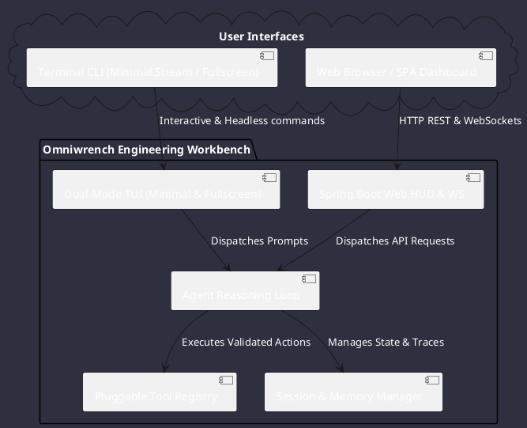

# Omniwrench 🛠️

**Omniwrench** is an autonomous, high-performance AI agent development framework and tri-interface engineering workbench (Headless CLI, Dual-Mode Terminal UI, and Reactive Web HUD) built in Java (Spring Boot 3.2+), inspired by **OpenCode**, **Antigravity CLI (`agy`)**, **OpenClaw**, **Claude Code**, **Aider**, and **Charmbracelet Crush**.

---

## 🧭 Navigation & Core Catalogs

* **[Topics Index](topics_index.md)**: Exhaustive sitemap of all 100+ documentation pages.
* **[User Manual & Guides](user_guide/overview.md)**:
  - [Overview & Quick Start](user_guide/overview.md)
  - [Dual-Mode Cyberpunk TUI User Manual (Minimal & Full-Screen Workbench)](user_guide/tui_guide.md)
  - [Web HUD & Telemetry Dashboard](user_guide/web_guide.md)
  - [Operations & Resumption Guide](user_guide/resuming_operations.md)
  - [Configuration & Environment Guide](user_guide/configuration_guide.md)
  - [Operational Workflows](user_guide/workflows.md)
* **[Architecture Specifications](architecture/architecture_index.md)**:
  - [System Components](architecture/components.md) (28 dedicated component pages: `OmniwrenchTuiDashboard`, `TerminalRenderer`, `ThemeEngine`, `AgentEngine`, `SmartModelRouter`, `JavaParserAstTool`, etc.)
  - [AI Terminal Agents Comparative Analysis & Fullscreen TUI Architecture](architecture/tui_agents_analysis.md)
  - [Package Dependencies](architecture/dependencies.md) & [Execution Sequences](architecture/sequences.md)
  - [Reasoning Activities](architecture/activities.md) & [Class Diagrams](architecture/classes.md)
  - [Interfaces & SPIs](architecture/interfaces.md), [File Formats](architecture/file_formats.md), [Configuration Specs](architecture/configuration.md)
* **[Requirements Register](requirements/requirements_index.md)**: 57 dedicated requirement specifications (`REQ-00001` through `REQ-00099`).
* **[Features Register](features/features_index.md)**: 41 functional capability definitions (`FR-00001` through `FR-00041`).
* **[Use Cases Register](use_cases/use_cases_index.md)**: 12 dedicated operational scenario specifications (`UC-00001` through `UC-00012`).
* **[Project Management & Tasks](project/project_management.md)**: 2026-2029 Industrial Infrastructure governance and active task records (`TSK-20260822-001` through `TSK-20261101-017`).
* **[Project Rules & Standards](architecture/rules_index.md)**: Mission-critical constraints (`CS-0010` to `CS-0070`).
* **[Comparative Extraction Reports](reports/reports_index.md)**: Deep analysis of Antigravity SDK, OpenClaw, and OpenCode.
* **[Knowledge Base & ADRs](knowledge/knowledge_base.md)**: Architectural Decision Records (`ADR-0001` through `ADR-0063`).
