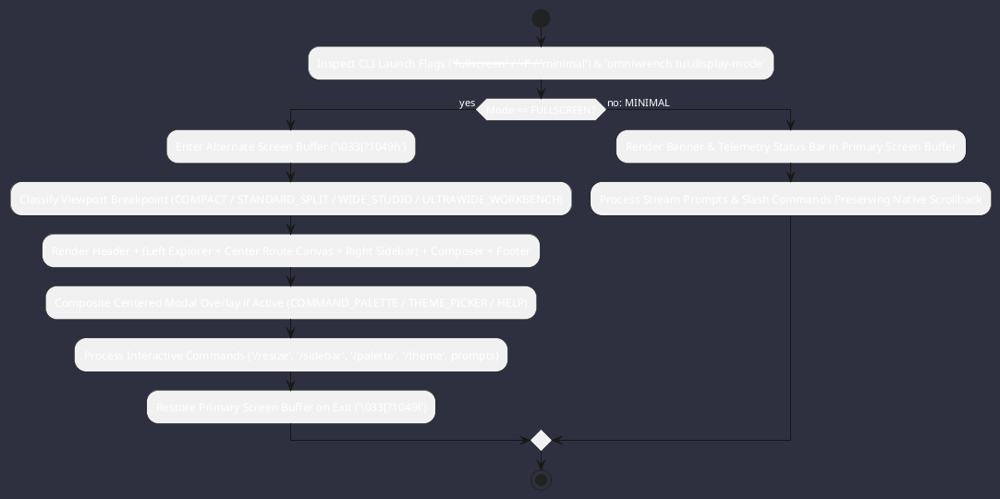

# REQ-00100: Dual-Mode Minimal Inline Stream & Full-Screen Dynamically Resizable TUI Workbench

## Requirement Metadata

| Property | Value |
|---|---|
| **Requirement ID** | `REQ-00100` |
| **Title** | Dual-Mode Minimal Inline Stream & Full-Screen Dynamically Resizable TUI Workbench |
| **Traceability** | [ADR-0005, ADR-0013, ADR-0043, ADR-0063](../knowledge/knowledge_base.md) |
| **Priority** | Critical |
| **Verification Method** | Multi-Tier Functional, Boundary & Concurrency Stress Tests (`FullscreenTuiWorkbenchTest`) |
| **Status** | Implemented |

## Description

Omniwrench shall provide a pluggable dual-mode Terminal User Interface (`TuiViewModeEngine`) supporting both:
1. **Minimal Inline Stream Mode (`MinimalTuiModeEngine` / `TuiDisplayMode.MINIMAL`)**: Operates in the primary terminal screen buffer preserving native scrollback, mouse selection, and stream output (`omniwrench tui` / `--minimal`).
2. **Full-Screen Dynamically Resizable Workbench Mode (`FullscreenTuiModeEngine` & `FullscreenTuiLayout` / `TuiDisplayMode.FULLSCREEN`)**: Operates inside the alternate screen buffer (`\033[?1049h` $\to$ `\033[?1049l`) with dedicated `HOME` and `SESSION` routes, 4 responsive viewport breakpoints (`COMPACT <80`, `STANDARD_SPLIT 80..119`, `WIDE_STUDIO 120..159`, `ULTRAWIDE_WORKBENCH >=160`), OpenCode-style dockable right `CONTEXT & TELEMETRY` sidebar, ultrawide left `EXPLORER`, code-fence-preserving word wrapper (`wrapTextPreservingCode`), live `/resize <cols> <rows>` reflow, and centered modal overlays (`/palette`, `/themes`, `/help`), invokable via `--fullscreen` (`-f`, `tui-full`, `fullscreen`).

## Rationale & Context

Synthesizes the best ergonomics of inline terminal agents (**Claude Code**, **Aider**, **Antigravity CLI inline**) and full-screen workbench agents (**OpenCode**, **Antigravity CLI full-screen**, **OpenClaw**, **Charmbracelet Crush**) inside a single cohesive Java engine.

## Architecture Specification & Activity Flow

## Acceptance & Verification Criteria

1. **Functional Compliance**: Satisfies all criteria defined in [ADR-0063](../knowledge/knowledge_base.md) and [AI Terminal Agents Analysis](../architecture/tui_agents_analysis.md).
2. **Quality Gate**: Conforms strictly to `CS-0010` through `CS-0070` and `CS-0055` with 0 Checkstyle and 0 PMD violations.
3. **Automated Testing**: Verified by `FullscreenTuiWorkbenchTest`, `OmniwrenchTuiDashboardTest`, and `TuiRunnerTest`.
4. **Documentation**: Fully indexed in the [Requirements Register](requirements_index.md) and [Features Register](../features/features_index.md).
