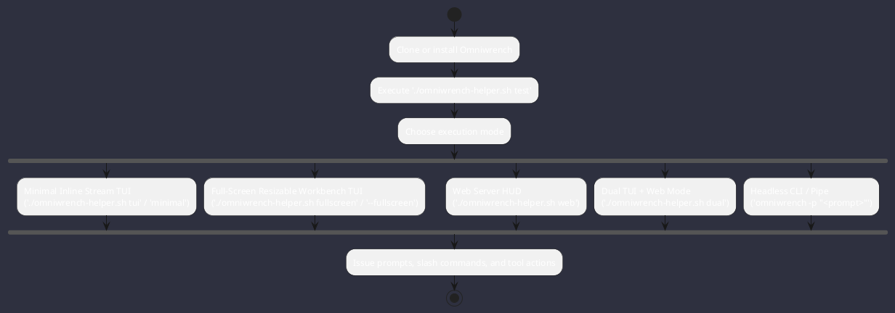

# Omniwrench User Manual: Overview & Quick Start

Omniwrench is an autonomous engineering assistant and tri-interface developer workbench (Headless CLI, Dual-Mode Terminal UI, and Reactive Web HUD) for mission-critical software engineering.



## System Requirements
- **Java / GraalVM**: GraalVM SDK / OpenJDK 17, 21, or 25 (tested with Oracle GraalVM / GraalVM Community Edition and Eclipse Temurin).
- **Native Image**: GraalVM Native Image for standalone AOT compilation (<20ms startup), plus optional `musl-gcc` / container support for fully static `musl` binaries.
- **Maven**: Apache Maven 3.8+ (supports multi-threaded builds up to 6 threads: `mvn -T 6 clean test`).
- **Python**: Python 3.10+ (for GraalVM installer helper and `mkdocs-kit` documentation engine).
- **Operating System**: Linux (Debian, SUSE, RHEL, Arch, Ubuntu), macOS, or Windows (WSL2).
- **Terminal**: Modern ANSI/VT100 terminal supporting XTerm-256 colors and UTF-8 box characters (Alacritty, Kitty, WezTerm, iTerm2, GNOME Terminal, SSH, `tmux`).

---

## 📦 Four-Tier Packaging & Distribution Commands

```bash
# Automatically download, verify SHA-256, and configure the latest GraalVM SDK
./omniwrench-helper.sh setup-graalvm

# Activate environment in current terminal session
source ./activate-env.sh

# 1. Build traditional JVM Spring Boot fat JAR (omniwrench-app-0.1.0-SNAPSHOT.jar)
./omniwrench-helper.sh build-jvm

# 2. Build dynamic GraalVM Native Image binary (omniwrench)
./omniwrench-helper.sh build-native

# 3. Build zero-dependency fully static musl Native Image binary (omniwrench-static)
./omniwrench-helper.sh build-static-native

# 4. Build self-contained Linux AppImage & jlink distribution bundle
./omniwrench-helper.sh build-appimage
```

---

## ⚡ Quick Start: Running Omniwrench

### 1A. Full-Screen Dynamically Resizable TUI Workbench (`--fullscreen` / `-f`)
Inspired by **OpenCode**, **Antigravity CLI (`agy`)**, **OpenClaw**, and **Charmbracelet Crush**, this mode runs in the terminal's alternate screen buffer (`\033[?1049h`) with `HOME` and `SESSION` routes, a dockable right `CONTEXT & TELEMETRY` sidebar, 4 responsive viewport breakpoints (`COMPACT`, `STANDARD_SPLIT`, `WIDE_STUDIO`, `ULTRAWIDE_WORKBENCH`), live `/resize <cols> <rows>` reflow, and centered modal overlays (`/palette`, `/themes`, `/help`):
```bash
./omniwrench-helper.sh fullscreen
# or via CLI launch options:
java -jar omniwrench-app/target/omniwrench-app-0.1.0-SNAPSHOT.jar tui --fullscreen
java -jar omniwrench-app/target/omniwrench-app-0.1.0-SNAPSHOT.jar -f
```

### 1B. Minimal Inline Stream TUI (`tui` / `--minimal`)
Inspired by **Claude Code**, **Aider**, and **Antigravity CLI inline mode**, this mode runs directly in the primary terminal buffer, preserving native terminal scrollback and mouse text selection:
```bash
./omniwrench-helper.sh tui
# or explicitly:
./omniwrench-helper.sh minimal
java -jar omniwrench-app/target/omniwrench-app-0.1.0-SNAPSHOT.jar tui --minimal
```

### 2. Single-Page Application (Web HUD)
Launch in Web or Dual mode to access the browser HUD at `http://localhost:8080`:
```bash
./omniwrench-helper.sh web
# or dual mode (TUI + Web server active):
./omniwrench-helper.sh dual
```

### 3. Single-Shot Non-Interactive CLI Prompt
Execute direct prompts or stdin pipes for CI/CD automation without entering interactive mode:
```bash
java -jar omniwrench-app/target/omniwrench-app-0.1.0-SNAPSHOT.jar -p "Analyze project code"
java -jar omniwrench-app/target/omniwrench-app-0.1.0-SNAPSHOT.jar -p "Analyze project code" --json
echo "Check workspace status" | java -jar omniwrench-app/target/omniwrench-app-0.1.0-SNAPSHOT.jar -
```

### 4. Local Model Provisioning & Management
Search and pull local quantized GGUF weights directly from the Ollama Registry or HuggingFace Hub:
```bash
# Search for available models
java -jar omniwrench-app/target/omniwrench-app-0.1.0-SNAPSHOT.jar -p "/model search gemma"

# Pull model weights from Ollama library
java -jar omniwrench-app/target/omniwrench-app-0.1.0-SNAPSHOT.jar -p "/model pull gemma4:e2b"

# List locally cached models
java -jar omniwrench-app/target/omniwrench-app-0.1.0-SNAPSHOT.jar -p "/model list"
```

---

## 🔄 Resuming Operations on Another Machine

To clone and resume work on Omniwrench on a new machine:
1. **Clone repository**:
   ```bash
   git clone <repo-url> omniwrench
   cd omniwrench
   ```
2. **Setup GraalVM / Java 21+**:
   ```bash
   ./omniwrench-helper.sh setup-graalvm
   source ./activate-env.sh
   ```
3. **Build & Verify Full Test Suite**:
   ```bash
   mvn -T 6 clean test
   ```
4. **Compile Documentation Site & PDF Manual**:
   ```bash
   ./helpers/build-docs.sh build
   ```
5. **Launch Interactive TUI (Fullscreen or Minimal) or Web HUD**:
   ```bash
   ./omniwrench-helper.sh fullscreen
   # or ./omniwrench-helper.sh tui
   # and open http://localhost:8080 in browser when running in dual/web mode
   ```
