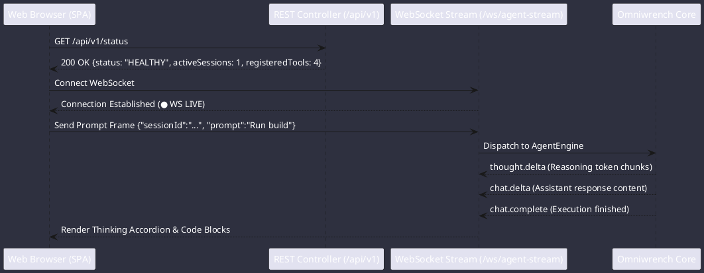

# Web HUD & Telemetry Dashboard

Omniwrench embeds a modern, responsive Single-Page Application (SPA) Web HUD and a high-throughput Spring Web & WebSocket server for remote monitoring, pair-programming, and real-time reasoning visualization.

The web interface is inspired by **OpenCode**'s design system (`#101010` dark theme palette, Cyberpunk neon accents, glassmorphic headers, and collapsible thinking stream accordions).



---

## Accessing the Web HUD

When running in `dual` or `web` mode, the web interface is available at:
```text
http://localhost:8080/
```
*(or custom port specified via `server.port` or `PORT` environment variable).*

---

## Key Interface Components

### 1. Header & Telemetry Bar
- **Brand Title**: `🛠️ OMNIWRENCH :: WORKBENCH`
- **Active Goal Pill**: Displays the current high-level objective (e.g. `🎯 GOAL: Implement reactive web client`). Click the pill or pencil icon to open the **Goal Editor Dialog** (`<dialog>`).
- **Environment Indicator**: Displays `[ENV: LOCAL/WEB]` or `[ENV: REMOTE/WEB]`.
- **WebSocket Status**: Real-time indicator (`● WS LIVE`, `WS CONNECTING...`, or `WS OFFLINE` with automatic reconnect).
- **Navigation Buttons**: Quick access to **Diagnostics**, **Tools Catalog**, and **Help Guide**.

### 2. Multi-Session Management (Sidebar)
- **Sessions Drawer**: Lists all active workspace sessions with UUID, message count badges, and workspace root directories.
- **`+ New Session` Button**: Instantly provisions a fresh isolated conversation context via `POST /api/v1/sessions`.
- **Session Switching**: Click any session item to load its historical conversation turns via `GET /api/v1/sessions/{id}/messages`.

### 3. Timeline & Reasoning Stream
- **User Messages**: Cyan-accented dialogue cards with timestamps.
- **Agent Responses**: Magenta-accented cards with markdown rendering, inline code, and syntax-highlighted code blocks equipped with **One-Click Copy** buttons.
- **Collapsible Thinking Accordion**: The internal reasoning stream is rendered inside an amber accordion (`REASONING / THINKING STREAM`). Operators can expand it to inspect the step-by-step chain of thought or collapse it for a clean overview.
- **Side-Channel (`/btw`) Cards**: Cyan-bordered cards displaying side-channel questions and answers without interrupting the main conversation thread.

### 4. Interactive Composer
- **Auto-growing Textarea**: Submit via `Ctrl+Enter` or `Cmd+Enter`.
- **Reasoning Effort Selector**: Adjust reasoning intensity (`Off`, `Low`, `Medium`, `High`, `Max`).
- **Action Chips**:
  - `/btw`: Insert side-channel query prefix.
  - `/goal`: Insert goal update prefix.
  - `/env`: Show runtime diagnostics.
  - `/clear`: Clear conversation history.

### 5. Slide-Out Inspector Drawer
- **System Diagnostics Tab**: Live JVM runtime version, OS architecture, memory usage, active sessions, and WebSocket telemetry.
- **Registered Tools Catalog Tab**: Complete catalog of active tools (`command_execution`, `file_operations`, `model_manager`) with descriptions and input JSON schema parameters.

---

## REST API Reference

| Method | Endpoint | Description |
|---|---|---|
| `GET` | `/api/v1/status` | Workbench health status, JVM version, active sessions, registered tool count. |
| `GET` | `/api/v1/tools` | List of all registered tool definitions and JSON parameter schemas. |
| `GET` | `/api/v1/sessions` | List of all active sessions (session ID, workspace root, message count, created timestamp). |
| `POST` | `/api/v1/sessions` | Create a new isolated session (`{"workspacePath": "/path"}` optional). |
| `GET` | `/api/v1/sessions/{id}/messages` | Retrieve full transcript of conversation messages for a session. |
| `DELETE` | `/api/v1/sessions/{id}/messages` | Clear conversation history for a session. |
| `POST` | `/api/v1/sessions/{id}/prompt` | Submit a prompt to the agent reasoning engine synchronously. |

---

## WebSocket Streaming Protocol (`/ws/agent-stream`)

Connect via `ws://<host>:<port>/ws/agent-stream`.

### Client Request Frame
```json
{
  "sessionId": "a1b2c3d4-...",
  "prompt": "Analyze code structure"
}
```

### Server Event Frames
1. **`thought.delta`**:
   ```json
   {
     "type": "thought.delta",
     "data": {
       "sessionId": "a1b2c3d4-...",
       "thinking": "Evaluating dependencies...\nSelected strategy: AST traversal"
     }
   }
   ```
2. **`chat.delta`**:
   ```json
   {
     "type": "chat.delta",
     "data": {
       "sessionId": "a1b2c3d4-...",
       "role": "assistant",
       "content": "Analysis complete. The project contains 7 modules."
     }
   }
   ```
3. **`chat.complete`**:
   ```json
   {
     "type": "chat.complete",
     "data": {
       "sessionId": "a1b2c3d4-...",
       "status": "DONE"
     }
   }
   ```
