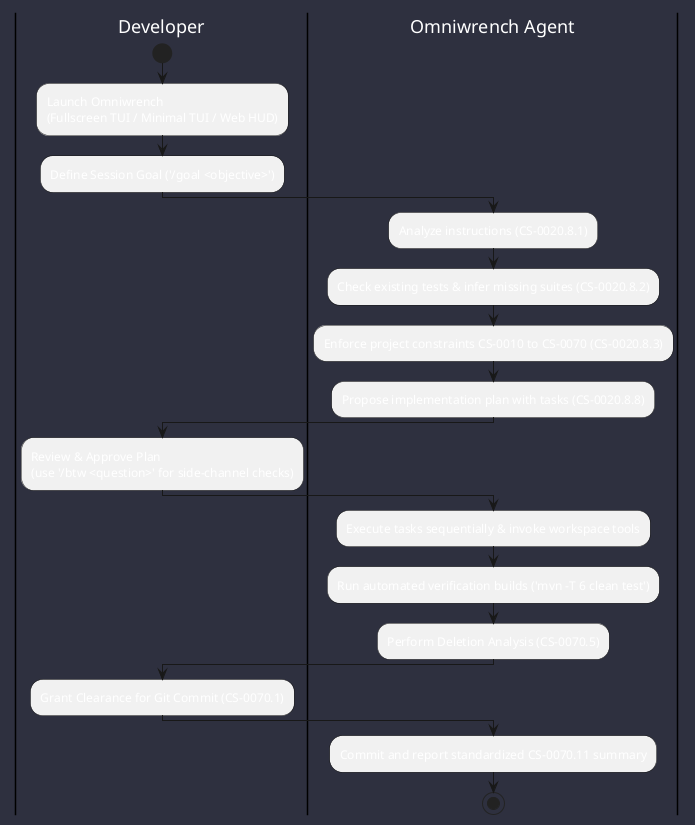

# Operational Workflows

Detailed step-by-step developer workflows for pairing with Omniwrench across Fullscreen Resizable TUI, Minimal Stream TUI, Web HUD, and Headless CLI modes.



---

## 1. Interactive Full-Screen Workbench Workflow (`--fullscreen` / `-f`)

1. **Launch Full-Screen Workbench**:
   ```bash
   ./omniwrench-helper.sh fullscreen
   ```
2. **Inspect Command Palette & Select Theme**:
   - Type `/palette` (or `?`) to open the centered Command Palette overlay.
   - Type `/themes` or `/theme opencode` to switch the active XTerm-256 semantic palette.
3. **Configure Viewport & Sidebar Docking**:
   - In wide terminals (`>= 80` cols), the right `CONTEXT & TELEMETRY` sidebar docks automatically (`auto`).
   - Use `/sidebar toggle` (or `/sidebar hide` / `/sidebar show`) to control sidebar docking manually.
   - Use `/resize 160 45` to test or adapt to custom terminal geometry (activating the 3-pane `ULTRAWIDE_WORKBENCH` with the left `EXPLORER` pane).
4. **Set Session Goal & Execute Prompts**:
   - Type `/goal Implement feature X with zero Checkstyle/PMD violations`.
   - Submit prompts; the view transitions automatically from `HOME :: WELCOME` to `SESSION TRANSCRIPT`.
   - Toggle reasoning stream visibility with `/thinking toggle` and tool output details with `/tools toggle`.
5. **Side-Channel Queries & Clipboard Export**:
   - Ask an ephemeral question without polluting the main task thread via `/btw What is the parameter limit in checkstyle.xml?` and dismiss with `/btw clear`.
   - Copy the latest assistant response directly to your local clipboard over SSH or `tmux` via `/copy` (OSC 52 tunneling).

---

## 2. Minimal Inline Stream Workflow (`tui` / `--minimal`)

1. **Launch Minimal Stream TUI**:
   ```bash
   ./omniwrench-helper.sh tui
   ```
2. **Execute Inline Commands**:
   - Use `/env` to inspect detected terminal mode (`STANDARD`, `SSH`, `TMUX`), OS architecture, and JVM version.
   - Use `/run <cmd>` and `/cat <file>` to inspect workspace state directly in your terminal's native scrollback buffer.
